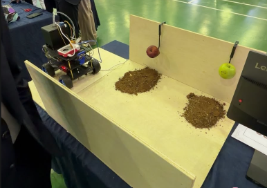
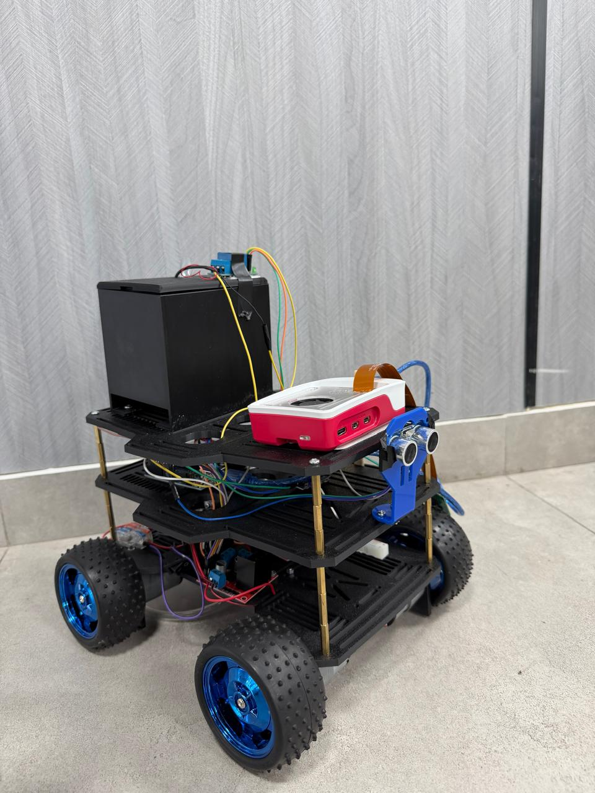
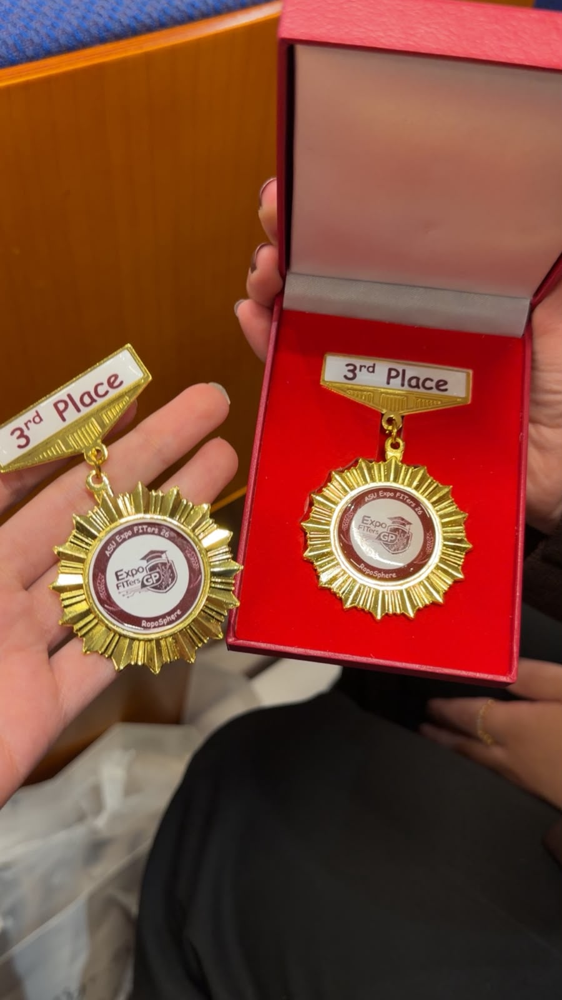

#  Agriculture Autonomous Mobile Robot
### Graduation Project — 2026

An intelligent autonomous agricultural robot that combines robotics, Artificial Intelligence (AI), and computer vision to monitor plant health, measure soil moisture, and support smart irrigation decisions.

##  Project Overview

Efficient irrigation and continuous plant monitoring are essential for modern agriculture. However, traditional systems often lack real-time monitoring, intelligent decision-making, and efficient water management.

To overcome these limitations, this project presents an autonomous agricultural robot that uses AI, computer vision, and soil moisture sensing to monitor plant health and support smart irrigation decisions.

The robot moves between plants, captures images, measures soil moisture, analyzes plant conditions, and activates irrigation when needed.

---

##  Project Objectives

- Develop an autonomous agricultural robot.
- Monitor plant health using computer vision.
- Measure soil moisture in real time.
- Improve irrigation efficiency.
- Support data-driven irrigation decisions.

---

##  Project Features

- Autonomous Navigation
- Plant Image Capture & Analysis
- Soil Moisture Monitoring
- AI-Based Plant Health Assessment
- Automatic Irrigation System
- Firebase Cloud Synchronization
- Real-Time Alerts & Notifications
- Mobile Application Dashboard
- Irrigation History & Monitoring Reports

---

##  Hardware Components

| Component | Purpose |
|---|---|
| Raspberry Pi | Main controller |
| Arduino | Hardware control |
| Soil Moisture Sensor | Measures soil moisture |
| RGB Camera | Captures plant images |
| Ultrasonic Sensors | Obstacle detection |
| DC Motors | Robot movement |
| Water Pump & Tank | Automatic irrigation |

---

##  Software & AI Technologies

| Technology | Purpose |
|---|---|
| Flutter & Dart | Mobile application |
| Python | System programming |
| OpenCV | Image processing |
| YOLOv8 | Plant detection |
| Gemini | AI-based analysis |
| ChatGPT | AI-generated explanations |
| Firebase | Cloud synchronization |
| Google Colab | Model training |
| GitHub | Version control |
| VS Code | Development environment |

---

##  AI Training Dataset

The AI model was trained using a Kaggle dataset containing plant images from four fruit categories.

**Dataset Information:**

- Total Images: 6,567
- Dataset Size: Approximately 19 GB
- Number of Classes: 17
- Categories:
  - Apple
  - Guava
  - Mango
  - Pomegranate

**Dataset Split:**

| Dataset | Percentage |
|---|---:|
| Training | 70% |
| Validation | 15% |
| Testing | 15% |

The dataset represents healthy and diseased plant conditions.

---

##  System Methodology

The robot follows nine main stages:

1. **Robot Movement:** The robot starts moving.
2. **Plant Detection:** Detects a plant.
3. **Image Capture:** Captures a plant image.
4. **Soil Measurement:** Measures soil moisture.
5. **AI Analysis:** Analyzes plant condition.
6. **Irrigation Decision:** Determines whether irrigation is needed.
7. **Water Pump Activation:** Activates the pump if required.
8. **Cloud Synchronization:** Sends data to Firebase.
9. **Mobile Visualization:** Displays results in the mobile application.

---

##  Future Work

The project can be further improved through:

- Using solar energy as a renewable power source.
- Developing an automatic battery charging station.
- Developing an automatic water refilling station.
- Creating a Raspberry Pi-based mapping system for better monitoring and field management.
- Integrating fertilizer and nutrient sensors for precise plant nutrition management.

---

##  Conclusion

This project presents a smart agricultural monitoring and irrigation system that combines robotics, artificial intelligence, and computer vision into a single platform.

The system enables real-time plant monitoring, supports intelligent irrigation decisions, and performs automated watering when required.

As a result, it improves water efficiency, reduces manual labor, and contributes to more sustainable and data-driven agricultural practices.

---

##  Project Gallery

### Robot Exhibition

### Physical Robot Prototype

### Third Place Award

---

##  Project Demonstration

Watch the robot demonstration video recorded during the university exhibition.

[▶ Watch the Project Demonstration](robot-demonstration.mp4)

---

## 🏆 Achievement

**Third Place – ASU Expo FITers GP 2026**

Awarded third place for the agricultural robotics graduation project.
--

**Agriculture Autonomous Mobile Robot — Graduation Project **

*Applied Science Private University | 2026*

## 2. Problem Statement

Traditional agricultural practices often depend on manual plant monitoring and conventional irrigation methods.

These practices can make it difficult to continuously monitor plant health, identify plant conditions, and manage water consumption efficiently.

This project addresses these challenges by developing an autonomous agricultural robot that integrates plant monitoring, soil moisture measurement, and AI-based analysis to support smart irrigation decisions.

The main goal is to reduce manual intervention and improve agricultural monitoring and irrigation management.

## 3. Technologies Used

### Artificial Intelligence & Computer Vision
- YOLOv8
- OpenCV
- Gemini
- ChatGPT

### Programming Languages
- Python
- Dart

### Mobile Application Development
- Flutter

### Cloud & Database
- Firebase

### Development Tools
- Google Colab
- GitHub
- Visual Studio Code

### Hardware Technologies
- Raspberry Pi
- Arduino
- RGB Camera
- Soil Moisture Sensor
- Ultrasonic Sensors
- DC Motors
- Water Pump & Tank

## 4. Methodology

The robot operates through nine sequential stages:

1. **Robot Movement:** The robot starts moving.
2. **Plant Detection:** Detects a plant.
3. **Image Capture:** Captures an image of the plant.
4. **Soil Moisture Measurement:** Measures soil moisture.
5. **AI Analysis:** Analyzes the plant condition.
6. **Irrigation Decision:** Determines whether irrigation is needed.
7. **Water Pump Activation:** Activates the water pump if required.
8. **Firebase Integration:** Sends data to Firebase.
9. **Mobile Application:** Displays the results in the mobile application.

## 5. Screenshots & Results

### Physical Robot Prototype

### Project Exhibition

### Project Achievement

### Demonstration Video

[Watch the Agricultural Robot Demonstration](robot-demonstration.mp4)

The project was demonstrated using a physical robotic prototype during the university exhibition.

**Achievement:** Third Place – ASU Expo FITers GP 2026.
